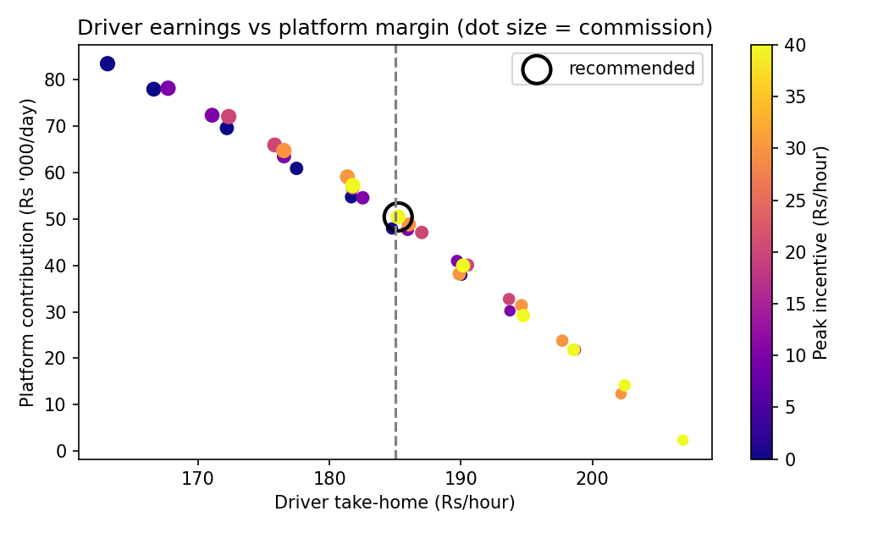
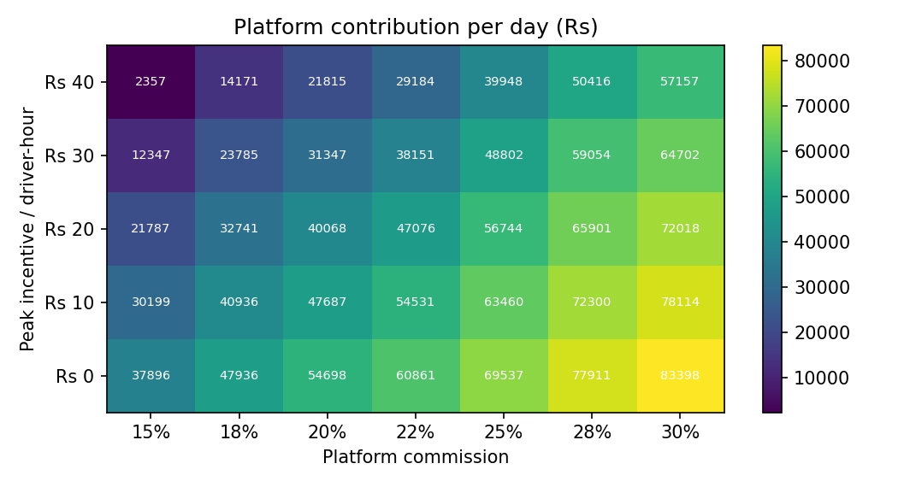
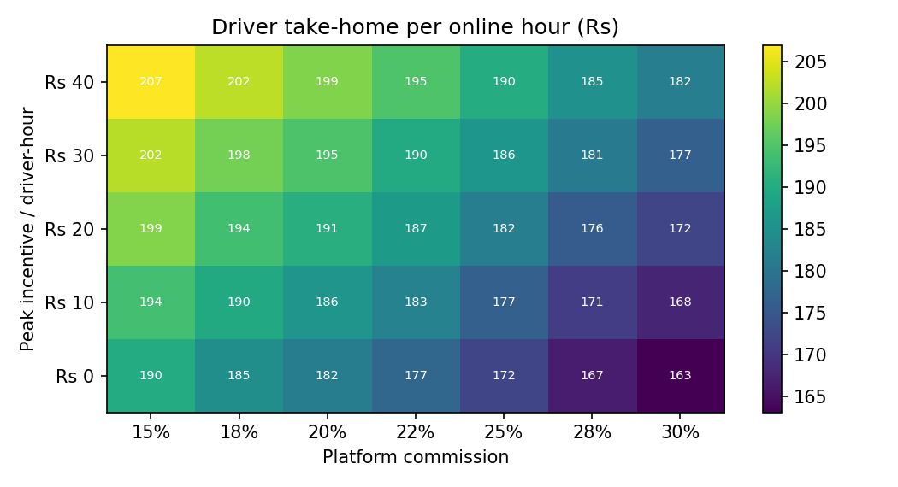

# Ride-Hailing Marketplace Simulator

A minute-by-minute **Monte Carlo simulation** of a two-sided ride-hailing marketplace. I built it to answer one question a city manager faces: *how should the platform pay drivers so that enough of them stay online, without giving away its margin?*

## The model

- **Riders**: Poisson arrivals that follow an hourly demand curve with morning and evening peaks (~3,900 requests a day in a 10 × 10 km zone). Riders accept any pickup ETA up to 4 minutes; beyond that, the chance they cancel rises exponentially.
- **Dispatch**: each request goes to the nearest idle online driver, adjusted for road detours. If the ETA is over 15 minutes, the rider sees "no cabs".
- **Drivers**: the number online each hour responds to expected take-home pay, with a supply elasticity of 0.8. Two levers move it:
  - platform **commission** (all hours)
  - a **peak-hour incentive** in ₹ per online hour (8–11 am, 5–9 pm)
- **Economics**: fare = ₹40 + ₹12/km. Platform contribution = commission − incentives − ₹6 ops cost per trip.

I swept 35 policies (7 commission levels × 5 incentive levels) and simulated each over 10 random days, reporting the mean and a 95% confidence interval.

## Key results

| | Baseline | Recommended |
|---|---|---|
| Commission | 20% | 28% |
| Peak incentive (₹/hr) | 0 | 40 |
| Completion rate | 72.9% | 74.2% |
| Avg pickup ETA (min) | 4.43 | 4.28 |
| Driver take-home (₹/hr) | 182 | 185 |
| Contribution / day (₹) | 54,698 ± 290 | 50,416 ± 490 |

- The baseline **fails the driver-retention floor** (₹185/hr), so some margin has to go back to drivers. The question is how.
- A flat commission cut alone has to go all the way down to **15%**, leaving ₹37,896/day.
- **Moving driver pay into peak hours** (higher base commission plus a ₹40 peak incentive) meets the same floor and keeps **₹12,521/day more (+33%)**. Money spent where supply is scarce does more than money spread across all hours.





## Run it

```bash
pip install -r requirements.txt
python run.py          # ~45 s; writes outputs/policy_sweep.csv, heatmaps, summary.md
python -m pytest -q
```

All city and market parameters live in the `City` dataclass in [`rhsim/sim.py`](rhsim/sim.py).

*All parameters are illustrative. This is not data from any company.*
